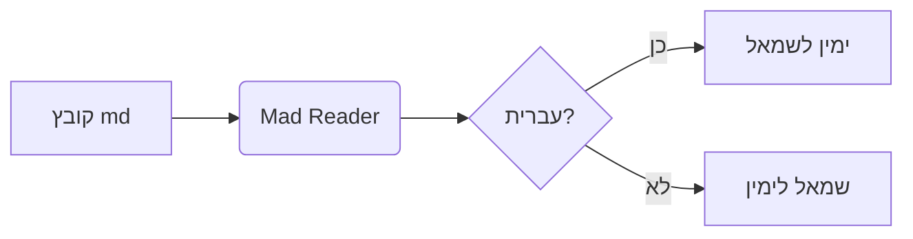
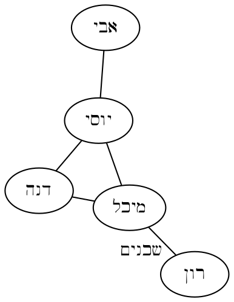

# Mad Reader — מדריך למשתמש

Mad Reader הוא קורא Markdown מהיר ל-Windows. הוא מציג Markdown בסגנון GitHub, מטפל נכון **בעברית ובשפות שנכתבות מימין לשמאל**, ולא מפריע לקריאה.

> [!TIP]
> בכל רגע אפשר ללחוץ <kbd>F1</kbd> כדי לראות את כל קיצורי המקלדת.

## פתיחת קבצים

- **לחיצה כפולה** על קובץ `.md` בסייר הקבצים (אחרי שמגדירים את Mad Reader כאפליקציית ברירת המחדל, ראו בהמשך).
- **גרירה ושחרור** של קובץ אחד או יותר לחלון. קבצים נוספים נפתחים כל אחד בחלון משלו.
- <kbd>Ctrl</kbd>+<kbd>O</kbd> או כפתור התיקייה בסרגל הכלים.
- בחירה מרשימת **הקבצים האחרונים** במסך הפתיחה (<kbd>Ctrl</kbd>+<kbd>H</kbd>). <kbd>Ctrl</kbd>+לחיצה פותחת את הקובץ בחלון חדש.

קישורים לקובצי Markdown אחרים נפתחים בתוך Mad Reader. כדי לחזור אחורה ולהתקדם בהיסטוריה משתמשים ב-<kbd>Alt</kbd>+<kbd>←</kbd> / <kbd>Alt</kbd>+<kbd>→</kbd>, או בכפתורי הצד של העכבר. קישורים לאתרים נפתחים בדפדפן, וקבצים מקומיים אחרים נפתחים באפליקציה המתאימה להם.

**רענון חי:** אפשר להשאיר קובץ פתוח ב-Mad Reader ולערוך אותו בכל עורך. התצוגה מתעדכנת ברגע השמירה ושומרת על מיקום הקריאה.

## עברית וכתיבה מימין לשמאל

Mad Reader קובע את הכיוון **לכל פסקה בנפרד**: לכל פריט ברשימה, כותרת, תא בטבלה וציטוט. הוא סופר כמה מילים בכל פסקה כתובות מימין לשמאל וכמה משמאל לימין, ומתעלם מקוד. לכן משפט בעברית שמתחיל במילה באנגלית עדיין מוצג מימין לשמאל. העמוד כולו, כולל תוכן העניינים, נפרש לפי הכיוון של רוב המסמך.

הכפתור **Auto / RTL / LTR** בסרגל הכלים (או <kbd>Ctrl</kbd>+<kbd>D</kbd>) כופה כיוון אחיד על כל המסמך.

החיפוש מתעלם מניקוד: חיפוש של `בראשית` ימצא גם `בְּרֵאשִׁית`.

קבצים ישנים בעברית שנשמרו בקידוד Windows-1255 מזוהים ומוצגים כראוי. קבצים בקידוד UTF-8 ו-UTF-16 עובדים כרגיל.

## שפת הממשק

את שפת התפריטים והכפתורים בוחרים בתפריט **Aa** ← **שפה**:

- **אוטומטי**: לפי שפת התצוגה של Windows
- **English**
- **עברית**: הממשק כולו מוצג מימין לשמאל

## נוסחאות מתמטיות

נוסחאות LaTeX מוצגות כמו ב-GitHub:

- בתוך שורה: `$E = mc^2$` ← $E = mc^2$
- בשורה נפרדת: `$$...$$` או בלוק קוד מסוג `math`

$$
\sum_{k=1}^{n} k = \frac{n(n+1)}{2}
$$

```math
\int_0^\infty e^{-x^2}\,dx = \frac{\sqrt{\pi}}{2}
```

סכומים כמו "עולה $5 ועוד $10" אינם נחשבים לנוסחה.

## תרשימים (Mermaid)

בלוק קוד מסוג `mermaid` מוצג כתרשים. התרשים מתאים את עצמו לערכת הנושא הבהירה או הכהה:



Mermaid יודע לצייר גם גרפים של נתונים: `pie` לתרשים עוגה, ו-`xychart-beta` לגרף עמודות או קו. ב-`xychart-beta` צריך לשים תוויות בעברית בתוך מירכאות: `x-axis ["ינו", "פבר", "מרץ"]`.

## גרפים (Graphviz)

בלוק קוד מסוג `dot` (או `graphviz`) מסודר בעזרת [Graphviz](https://graphviz.org), הכלי המקובל לרשתות, עצים וגרפים של תלויות. הוא מתאים גם לגרפים גדולים, ויש בו כמה סוגי פריסה (`dot`, `neato`, `circo`, `fdp`, `twopi`). גרף שלא הגדיר צבעים משלו מתאים את עצמו לערכת הנושא:



אפשר לכתוב שמות בעברית כמו שהם. שם עם רווח צריך מירכאות: `"Mad Reader"`. ל-Mermaid קל יותר לכתוב תרשימי זרימה פשוטים, תרשימי עוגה וצירי זמן. Graphviz עדיף לגרפים אמיתיים עם הרבה צמתים.

## הגדרה כאפליקציית ברירת המחדל

1. **מתקינים.** מריצים את תוכנית ההתקנה, או פותחים את `MadReader.exe` ולוחצים **התקנה** במסך הפתיחה. משורת הפקודה: `MadReader.exe --install`. אין צורך בהרשאות מנהל.
2. **מאשרים את ברירת המחדל.** ב-Windows רק *המשתמש* יכול לבחור אפליקציות ברירת מחדל. לוחצים **הגדרה כברירת מחדל** במסך הפתיחה, או בתפריט *⋯ ← הגדרות אפליקציית ברירת מחדל…*. בחלון ההגדרות שנפתח בוחרים ב-Mad Reader עבור `.md` (וגם עבור `.markdown`, אם משתמשים בו).

   אפשרות נוספת: לחיצה ימנית על קובץ `.md` ← **פתח באמצעות** ← **בחר אפליקציה אחרת** ← **Mad Reader** ← **תמיד**.

## נוחות קריאה

בתפריט **Aa** שבסרגל הכלים אפשר לשנות:

| הגדרה | אפשרויות |
|---|---|
| ערכת נושא | אוטומטי (לפי Windows), בהירה, ספיה, כהה. <kbd>Ctrl</kbd>+<kbd>T</kbd> עובר ביניהן |
| גופן | עם תגים או בלי תגים, שניהם עם תמיכה טובה בעברית |
| גודל טקסט | <kbd>Ctrl</kbd>+<kbd>+</kbd>, <kbd>Ctrl</kbd>+<kbd>−</kbd>, <kbd>Ctrl</kbd>+<kbd>0</kbd>, או <kbd>Ctrl</kbd>+גלגלת העכבר |
| ריווח שורות | צפוף, רגיל, מרווח |
| רוחב עמוד | צר, רגיל, רחב, מלא |
| כיוון | אוטומטי, ימין לשמאל, שמאל לימין |
| יישור לשני הצדדים | כבוי, פעיל |
| שפה | אוטומטי, English, עברית |

ההעדפות, גודל החלון ומיקומו ורשימת הקבצים האחרונים נשמרים.

## Markdown נתמך

כל מה שקיים ב-[CommonMark](https://commonmark.org) וב-Markdown של GitHub:

- כותרות, **מודגש**, *נטוי*, ~~קו חוצה~~, `קוד בתוך שורה`, קישורים ותמונות
- טבלאות עם יישור, רשימות משימות, הערות שוליים[^1] ורשימות הגדרה
- תיבות התראה של GitHub: `> [!NOTE]`, `[!TIP]`, `[!IMPORTANT]`, `[!WARNING]`, `[!CAUTION]`
- בלוקי קוד עם הדגשת תחביר לכ-150 שפות
- נוסחאות LaTeX ותרשימי Mermaid
- כותרת מטא-דאטה בתחילת הקובץ (YAML `---` או TOML `+++`) מוסתרת
- HTML בטוח בתוך המסמך (`<details>`, `<kbd>`, `<sup>`, `` ועוד). סקריפטים מוסרים תמיד.

- [x] רשימות משימות
- [ ] מוצגות אוטומטית

מונח
: גם רשימות הגדרה נתמכות.

[^1]: הערות השוליים מופיעות בסוף המסמך.

<details>
<summary>לחצו כדי להרחיב</summary>

אזורים מתקפלים עובדים כמו ב-GitHub.

</details>

## עדכונים

Mad Reader בודק אם יש גרסה חדשה בערך פעם ביום, בשקט וברקע. הבדיקה רק שואלת את GitHub מהי הגרסה האחרונה, ולא שולחת שום מידע עליכם או על הקבצים שלכם. כשיש גרסה חדשה, מופיע כרטיס קטן בפינת החלון:

- **מה חדש** מציג את הערות הגרסה.
- **עדכון** מוריד את תוכנית ההתקנה החדשה, בודק אותה, סוגר את Mad Reader, מתקין ופותח אותו מחדש עם אותו מסמך. זה לוקח כמה שניות.
- **דילוג על הגרסה הזאת** מפסיק את התזכורות עד שתצא הגרסה הבאה.

אפשר לבדוק ידנית בכל רגע דרך **⋯ ← בדיקת עדכונים…**. כדי לכבות את הבדיקה היומית, פותחים את **⋯ ← אודות Mad Reader** ומבטלים את הסימון ב**לבדוק עדכונים באופן אוטומטי**.

עותק נייד (שלא הותקן) פותח את דף ההורדה במקום להתעדכן בעצמו.

## ייצוא: PDF, Word ודף אינטרנט

**⋯ ← ייצוא…** (<kbd>Ctrl</kbd>+<kbd>Shift</kbd>+<kbd>S</kbd>) שומר את המסמך הפתוח בתור:

- **PDF**: העמוד כפי שהוא נראה, עם מספרי עמודים. בגודל A4 או Letter, לפי הגדרות האזור של Windows.
- **Word ‏(.docx)**: מסמך שאפשר לערוך ב-Word, ב-Google Docs או ב-LibreOffice. הכותרות משתמשות בסגנונות הכותרת של Word, כך שחלונית הניווט ותוכן העניינים עובדים. פסקאות, רשימות וטבלאות בעברית נשמרות מימין לשמאל. הנוסחאות הופכות למשוואות Word אמיתיות שאפשר לערוך. תרשימים, גרפים ותמונות נשמרים כתמונות, והקוד שומר על הצבעים שלו.
- **דף אינטרנט ‏(.html)**: קובץ יחיד שנפתח בכל דפדפן. התמונות שמורות בתוך הקובץ, התרשימים נשארים חדים (SVG) והנוסחאות נשמרות כ-MathML.

הייצוא תמיד בערכת הנושא הבהירה, בלי קשר לערכה שבה קוראים. תמונות מהאינטרנט נשארות כקישורים בקובץ ה-Word (ב-PDF וב-HTML הן מופיעות כרגיל).

<kbd>Ctrl</kbd>+<kbd>P</kbd> מדפיס את המסמך בלי ממשק האפליקציה.

## שורת הפקודה

```text
MadReader.exe [file.md]          פתיחת קובץ
MadReader.exe --install          התקנה למשתמש הנוכחי
MadReader.exe --uninstall        הסרה (עם --quiet להסרה שקטה)
MadReader.exe --register         רישום שיוך סוגי הקבצים לקובץ ההפעלה הזה
MadReader.exe --unregister       ביטול שיוך סוגי הקבצים
MadReader.exe --default-apps     פתיחת הגדרות ← אפליקציות ברירת מחדל
MadReader.exe --version
```

## איפה הדברים נשמרים

| מה | איפה |
|---|---|
| התוכנה (בהתקנה עצמית) | `%LOCALAPPDATA%\Programs\MadReader` |
| הגדרות וקבצים אחרונים | `%APPDATA%\MadReader\settings.json` |
| מטמון WebView | `%LOCALAPPDATA%\MadReader\WebView2` |

ההסרה נעשית דרך **הגדרות ← אפליקציות ← אפליקציות מותקנות ← Mad Reader**.
