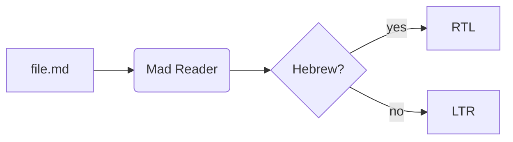
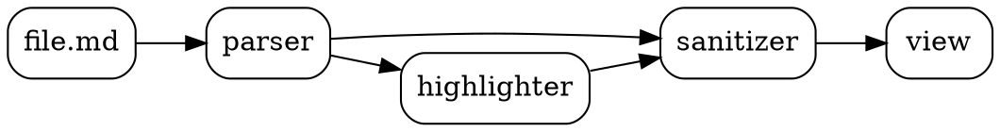

# Mad Reader — User Guide

Mad Reader is a fast Markdown reader for Windows. It renders GitHub-flavoured Markdown, handles **Hebrew and other right-to-left languages** properly, and stays out of your way.

> [!TIP]
> Press <kbd>F1</kbd> at any time to see all keyboard shortcuts.

## Opening files

- **Double-click** a `.md` file in Explorer (after you make Mad Reader the default app — see below).
- **Drag and drop** one or more files onto the window. Extra files open in their own windows.
- <kbd>Ctrl</kbd>+<kbd>O</kbd> or the folder button in the toolbar.
- Pick from **Recent** on the home screen (<kbd>Ctrl</kbd>+<kbd>H</kbd>). <kbd>Ctrl</kbd>+click opens it in a new window.

Links to other Markdown files open inside Mad Reader; use <kbd>Alt</kbd>+<kbd>←</kbd> / <kbd>Alt</kbd>+<kbd>→</kbd> (or the mouse back/forward buttons) to move through history. Web links open in your browser. Other local files open in their default app.

**Live reload:** keep a file open in Mad Reader while you edit it in any editor — the view refreshes the moment you save and keeps your scroll position.

## Hebrew and right-to-left text

Mad Reader decides the direction **per paragraph**, list item, heading, table cell and quote. It counts the right-to-left and left-to-right words in each block, ignoring code, so a Hebrew sentence that starts with an English word is still shown right-to-left. The whole page (and the table of contents) is laid out in the direction of the majority of the document.

Use the **Auto / RTL / LTR** button in the toolbar (or <kbd>Ctrl</kbd>+<kbd>D</kbd>) to force a direction for every block.

Search ignores Hebrew vowel marks (niqqud): searching for `בראשית` also finds `בְּרֵאשִׁית`.

Older Hebrew files saved in the Windows-1255 encoding are detected and displayed correctly. UTF-8 and UTF-16 files work as you would expect.

## Interface language

Choose the language of the menus and buttons in **Aa → Language**:

- **Auto**: follows the Windows display language
- **English**
- **עברית**: the whole interface switches to right-to-left

## Math

LaTeX math is typeset the same way as on GitHub:

- Inline: `$E = mc^2$` → $E = mc^2$
- Display: `$$...$$`, or a fenced code block with the `math` language

$$
\sum_{k=1}^{n} k = \frac{n(n+1)}{2}
$$

```math
\int_0^\infty e^{-x^2}\,dx = \frac{\sqrt{\pi}}{2}
```

Prices like "costs $5 and $10" are not treated as math.

## Diagrams (Mermaid)

A fenced code block with the `mermaid` language is drawn as a diagram. Diagrams follow the light or dark theme:



Mermaid also draws charts. For example, `pie`, and `xychart-beta` for bar and line charts. In `xychart-beta`, put Hebrew axis labels in quotes: `x-axis ["ינו", "פבר", "מרץ"]`.

## Graphs (Graphviz)

A code block with the `dot` (or `graphviz`) language is laid out by [Graphviz](https://graphviz.org), the standard tool for networks, trees and dependency graphs. It is good at large graphs and offers several layouts (`dot`, `neato`, `circo`, `fdp`, `twopi`). Graphs that don't set their own colours follow the theme:



Hebrew labels work as they are (`דנה -> יוסי`). Labels with spaces need quotes: `"Mad Reader"`. Mermaid is easier for simple flowcharts, pie charts and timelines. Graphviz is better for real graphs with many nodes.

## עברית

זהו קטע לדוגמה בעברית. Mad Reader מזהה את כיוון הטקסט של כל פסקה בנפרד, כך שמסמכים מעורבים בעברית ובאנגלית נראים נכון.

- פריט ראשון ברשימה
- פריט שני עם `קוד` בתוך השורה
- React היא ספרייה פופולרית — הפריט הזה מוצג מימין לשמאל למרות שהוא מתחיל באנגלית.

> ציטוט בעברית: "הספר הטוב ביותר הוא זה שקוראים שוב ושוב."

| שם | תפקיד | הערות |
|----|-------|-------|
| דנה | מפתחת | אחראית על ה-API |
| יוסי | מעצב | Figma ו-CSS |

> [!NOTE]
> קוד תמיד מוצג משמאל לימין, גם בתוך מסמך בעברית:

```python
def greet(name):
    return f"שלום, {name}!"
```

## Making Mad Reader your default Markdown app

1. **Install it.** Run the setup program, or start `MadReader.exe` and click **Install** on the home screen. (Command line: `MadReader.exe --install`.) Nothing needs admin rights.
2. **Confirm the default.** Windows only lets *you* choose default apps. Click **Set as default** on the home screen (or *⋯ → Default app settings…*). In the Settings page that opens, set Mad Reader for `.md` (and `.markdown` if you use it).

   Alternatively: right-click any `.md` file → **Open with** → **Choose another app** → **Mad Reader** → **Always**.

## Reading comfort

Open the **Aa** menu in the toolbar to change:

| Setting | Options |
|---|---|
| Theme | Auto (follows Windows), Light, Sepia, Dark — <kbd>Ctrl</kbd>+<kbd>T</kbd> cycles |
| Font | Sans or Serif (both with good Hebrew fallbacks) |
| Text size | <kbd>Ctrl</kbd>+<kbd>+</kbd>, <kbd>Ctrl</kbd>+<kbd>−</kbd>, <kbd>Ctrl</kbd>+<kbd>0</kbd>, or <kbd>Ctrl</kbd>+mouse wheel |
| Line spacing | Compact, Normal, Relaxed |
| Page width | Narrow, Normal, Wide, Full |
| Direction | Auto, RTL, LTR |
| Justify | Off / On |
| Language | Auto, English, עברית |

Your choices, the window size and position, and the recent-files list are remembered.

## Supported Markdown

Everything in [CommonMark](https://commonmark.org) and GitHub-flavoured Markdown:

- Headings, **bold**, *italic*, ~~strikethrough~~, `inline code`, links and images
- Tables with alignment, task lists, footnotes[^1], definition lists
- GitHub alerts: `> [!NOTE]`, `[!TIP]`, `[!IMPORTANT]`, `[!WARNING]`, `[!CAUTION]`
- Fenced code with syntax highlighting for ~150 languages
- LaTeX math and Mermaid diagrams
- Front matter (YAML `---` or TOML `+++`) is hidden
- Safe inline HTML (`<details>`, `<kbd>`, `<sup>`, ``, …). Scripts are always removed.

- [x] Task lists
- [ ] Render themselves

Term
: Definition lists are supported too.

[^1]: Footnotes appear at the end of the document.

<details>
<summary>Click to expand</summary>

Collapsible sections work as on GitHub.

</details>

## Updates

Mad Reader checks for a new version about once a day, quietly in the background. It only asks GitHub which version is the latest and sends nothing about you or your files. When there is a new version, a small card appears in the corner:

- **What's new** shows the release notes.
- **Update** downloads the new setup program, checks it, closes Mad Reader, installs and opens Mad Reader again with the same document. It takes a few seconds.
- **Skip this version** stops reminders until the next version comes out.

You can check by hand at any time in **⋯ → Check for updates…**. To turn off the daily check, open **⋯ → About Mad Reader** and clear **Check for updates automatically**.

A portable copy (one you didn't install) opens the download page instead of updating itself.

## Export: PDF, Word and web page

**⋯ → Export…** (<kbd>Ctrl</kbd>+<kbd>Shift</kbd>+<kbd>S</kbd>) saves the open document as:

- **PDF**: the page as you see it, with page numbers. A4 or Letter, following your Windows region.
- **Word (.docx)**: an editable document for Word, Google Docs or LibreOffice. Headings use Word's heading styles, so the navigation pane and a table of contents work. Hebrew paragraphs, lists and tables are right-to-left. Equations become real Word equations you can edit. Diagrams, graphs and pictures are embedded as images, and code keeps its colours.
- **Web page (.html)**: one self-contained file that opens in any browser. Pictures are inside the file, diagrams stay sharp (SVG), and equations are MathML.

Exports always use the light theme, whichever theme you read in. Pictures from the internet stay as links in the Word file (they appear normally in PDF and HTML).

**Copy as rich text** (⋯ menu, or <kbd>Ctrl</kbd>+<kbd>Shift</kbd>+<kbd>C</kbd>) puts the whole document on the clipboard with its formatting. Paste it into Gmail, Outlook, Word or Google Docs: headings, bold, lists, tables, coloured code, diagrams and pictures come along, and equations become Word equations in Word and Outlook. To copy only part of the page, select it and press <kbd>Ctrl</kbd>+<kbd>C</kbd> as usual.

<kbd>Ctrl</kbd>+<kbd>P</kbd> prints the document without the app chrome.

## Command line

```text
MadReader.exe [file.md]          open a file
MadReader.exe --install          install for the current user
MadReader.exe --uninstall        uninstall (add --quiet for silent)
MadReader.exe --register         register file associations for this exe
MadReader.exe --unregister       remove file associations
MadReader.exe --default-apps     open Settings → Default apps
MadReader.exe --version
```

## Where things are stored

| What | Where |
|---|---|
| Program (self-install) | `%LOCALAPPDATA%\Programs\MadReader` |
| Settings & recent files | `%APPDATA%\MadReader\settings.json` |
| WebView cache | `%LOCALAPPDATA%\MadReader\WebView2` |

Uninstall from **Settings → Apps → Installed apps → Mad Reader**.
