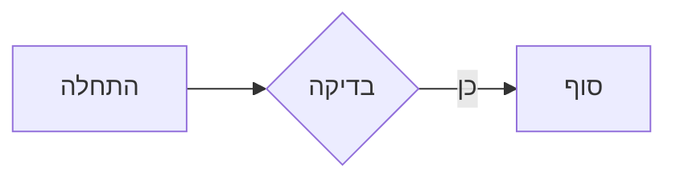
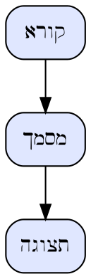

# מסמך בדיקה

זוהי פסקה בעברית עם מעט English בתוכה.

React היא ספרייה פופולרית לבניית ממשקים.

This paragraph is entirely in English.

## נוסחאות

אנרגיה: $E = mc^2$ ועוד.

$$
\sum_{k=1}^{n} k = \frac{n(n+1)}{2}
$$

```math
a^2 + b^2 = c^2
```

It costs $5 and $10 — not math.

## תרשים



## חיפוש

בְּרֵאשִׁית בָּרָא — וגם בראשית בלי ניקוד.

## קישורים

- [קובץ שני](second.md)
- [קפיצה לנוסחאות](#נוסחאות)
- [אתר](https://example.com)


```js
console.log("code stays LTR");
```



<script>window.__pwned = 1</script>

